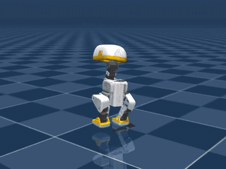
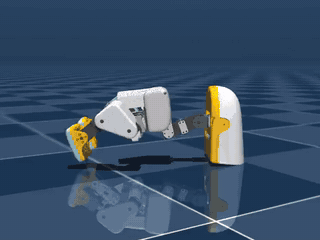
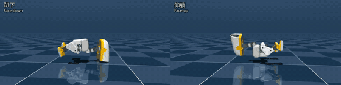
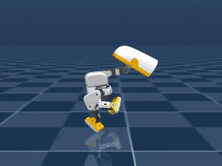
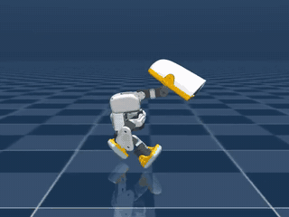
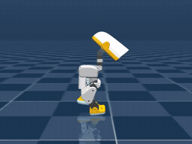
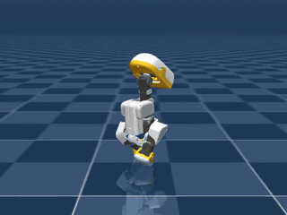

# microduck_rl_unilab

[English](README.md) | [中文](README.zh.md)

Pollen Robotics MicroDuck RL training on **UniLab's package distribution only**
(no UniLab source checkout). Tasks reproduce upstream
[pollen-robotics/microduck_rl](https://github.com/pollen-robotics/microduck_rl)
@ `29e887e` (alignment contract:
`src/microduck_rl_unilab/tasks/microduck/alignment_contract.py`;
audit script: `scripts/audit_microduck_alignment.py`).

This repository shows the two public UniLab integration seams:

1. **Task registration**: `UNILAB_EXTRA_REGISTRY_PACKAGES` lets UniLab's
   `ensure_registries()` import this repo's task package (including spawn
   subprocesses).
2. **Config composition**: Hydra `--config-dir` appends
   `src/microduck_rl_unilab/conf/<algo>` to the matching UniLab training
   script's config search path so external `task=<task>/<sim>` owner YAML
   participates in composition. The conf tree is split by algorithm
   (`conf/ppo/`, `conf/sac/`), matching UniLab's in-repo layout.

Train, eval, and runner/learner/collector all come from the `unilab` wheel.
This repo only ships task code (manager terms / recovery terms / BAM action,
and so on), owner configs, and robot XML assets.

## Gaits at a glance

Trained, checked policies with their weights in `examples/`. Click a clip for
its metrics and reproduce commands.

<table>
  <tr>
    <td align="center" width="33%">
      <a href="examples/velocity_flat_mujoco/"></a><br>
      <b>Walk</b> (<code>microduck_velocity_flat</code>)<br>
      Tracks a 0.4 m/s forward command
    </td>
    <td align="center" width="33%">
      <a href="examples/standup/"></a><br>
      <b>Stand up</b> (<code>microduck_standup_flat</code>)<br>
      From face-down and face-up, also sit-to-stand
    </td>
    <td align="center" width="33%">
      <a href="examples/velstand_getup/"></a><br>
      <b>Walk and recover</b> (<code>microduck_velstand_flat</code>)<br>
      Gets up from face-down (left) and face-up (right) within 8 s; half speed
    </td>
  </tr>
  <tr>
    <td align="center">
      <a href="examples/sprint_straight_fast/"></a><br>
      <b>Straight sprint</b> (<code>sprint_straight_fast</code>)<br>
      1.15 m/s, holds its line for 300 s
    </td>
    <td align="center">
      <a href="examples/sprint_straight_cmd/"></a><br>
      <b>Speed-command sprint</b> (<code>sprint_straight_cmd</code>)<br>
      Follows 0.3–1.2 m/s; clip at a 1.2 m/s command
    </td>
    <td align="center">
      <a href="examples/sprint_straight_head/"></a><br>
      <b>Head-over-trunk sprint</b> (<code>sprint_straight_head</code>)<br>
      Follows 0.3–1.0 m/s with servo-clamped targets
    </td>
  </tr>
  <tr>
    <td align="center">
      <a href="examples/sprint_steer/"></a><br>
      <b>Steering</b> (<code>sprint_steer</code>)<br>
      Forward speed and yaw rate both commanded; clip at 0.5 m/s, +0.4 rad/s. <a href="examples/sprint_stand/"><code>sprint_stand</code></a> adds standing still; start there for hardware
    </td>
    <td></td>
    <td></td>
  </tr>
</table>

The sprint gaits exist only in this repo; upstream microduck_rl has no sprint
task. How the sprint checkpoints differ is under
[Sprint lineage](#sprint-lineage). What is not available yet (velocity SAC,
MJWarp-only tasks) is listed in
[`CHANGELOG.md`](CHANGELOG.md#known-limitations).

To run a policy on the robot, see [`docs/DEPLOY.md`](docs/DEPLOY.md): the
observation and action contract, the exported ONNX in
[`examples/sprint_stand/deploy/`](examples/sprint_stand/deploy/), and the
known sim-to-real limits.

## Version

Current release: **0.1.0** (git tag `v0.1.0`). Release contents, checked
policies, and known limitations are in [`CHANGELOG.md`](CHANGELOG.md).

## Task × algorithm × backend matrix

| task | ppo | sac |
|------|-----|-----|
| `microduck_velocity_flat` | mujoco, motrix | mujoco, motrix |
| `microduck_velstand_flat` | mujoco | — |
| `microduck_standup_flat` | mujoco | — |
| `microduck_sprint_flat` and its 16 continuation owners (`robust`, `gaitfix`, `rollfix`, `steerfix`, `straightfix`, `straightspeed`, `straighthold`, `straightcmd`, `straightrange`, `straightclip`, `straightneck`, `straighthead`, `steer`, `steermix`, `stand`, `standturn`) | mujoco | — |
| `microduck_ground_pick_flat`, `microduck_sitstand_flat` | mjwarp | — |

Each sprint continuation owner is `microduck_sprint_<name>_flat`; the example
README that used it lists the exact commands.

PPO for `microduck_velocity_flat` finished the owner budget on 2026-10-15 (2048 envs, 500 iterations, `algo.seed=42`). The MuJoCo 10 s tracking shot at a 0.4 m/s forward command was checked: the robot stays up and steps. Motrix has no inference video.

| backend | final mean reward | checkpoint / video |
|---|---:|---|
| mujoco | 93.01 | [`model_499.pt`](examples/velocity_flat_mujoco/model_499.pt) / [`play_video.mp4`](examples/velocity_flat_mujoco/play_video.mp4) |
| motrix (`motrixsim-core==0.8.2`) | 145.44 | [`examples/velocity_flat_motrix/model_499.pt`](examples/velocity_flat_motrix/model_499.pt) |

Training reproduction status (complete requires both metrics and inference video to pass):

| policy | status | checkpoint / video |
|---|---|---|
| `microduck_standup_flat` PPO | Complete; 15000 iterations. Slow side views, in order: prone push-up, supine roll-up, sit-to-stand | [`examples/standup/model_14999.pt`](examples/standup/model_14999.pt) / [`play_video.mp4`](examples/standup/play_video.mp4) |
| `microduck_velstand_flat` PPO | Complete. On 64 forced falls, face-down and face-up both stand within 8 s (mean tilt 1.2°), with stand-still and with the default walk commands | [`examples/velstand_getup/model_12498.pt`](examples/velstand_getup/model_12498.pt) / [`play_video_getup.mp4`](examples/velstand_getup/play_video_getup.mp4) |
| `microduck_velocity_flat` SAC | **Failed validation**; all 5000 iterations completed, but inference repeatedly falls and resets, so this is not a usable policy. The failure clip stays in local `logs/` and is not published | — |
| `sprint_speed_1p68` PPO | Complete, about 1.68 m/s. Sprint is not an upstream microduck_rl task; it is a gait that exists only in this repo | [`examples/sprint_speed_1p68/model_11997.pt`](examples/sprint_speed_1p68/model_11997.pt) |
| `sprint_head_upright` PPO | Complete, about 1.32 m/s with the head up. Same: this repo only | [`examples/sprint_head_upright/model_14500.pt`](examples/sprint_head_upright/model_14500.pt) |
| `sprint_straight_long` PPO | Complete, about 0.83 m/s and straight for 300 s. Same: this repo only | [`examples/sprint_straight_long/model_19297.pt`](examples/sprint_straight_long/model_19297.pt) |
| `sprint_straight_fast` PPO | Complete, about 1.15 m/s, 300 s straight-pose pass 93–99% over three seeds. Same: this repo only | [`examples/sprint_straight_fast/model_27000.pt`](examples/sprint_straight_fast/model_27000.pt) / [`play_video_side.mp4`](examples/sprint_straight_fast/play_video_side.mp4) |
| `sprint_straight_cmd` PPO | Complete, follows a 0.3–1.2 m/s forward command (measured 0.31–1.12 m/s), 300 s straight-pose pass 90–99.6% across speeds. Same: this repo only | [`examples/sprint_straight_cmd/model_32250.pt`](examples/sprint_straight_cmd/model_32250.pt) / [`play_video_side_v0.6.mp4`](examples/sprint_straight_cmd/play_video_side_v0.6.mp4) |
| `sprint_straight_head` PPO | Complete, 0.3–1.0 m/s command with position targets clamped to the joint range and the head over the trunk (about 3 cm ahead instead of 9). 300 s straight-pose pass 93.6–100%. Same: this repo only | [`examples/sprint_straight_head/model_52250.pt`](examples/sprint_straight_head/model_52250.pt) / [`play_video_side_v0.5.mp4`](examples/sprint_straight_head/play_video_side_v0.5.mp4) |
| `sprint_steer` PPO | Complete. Forward speed 0.3–1.0 m/s and yaw rate both commanded, servo-clamped targets, head over the trunk. Yaw-rate error ≤ 0.05 rad/s at ±0.2 and ±0.4 rad/s, 97–100% survival while turning. Same: this repo only | [`examples/sprint_steer/model_55999.pt`](examples/sprint_steer/model_55999.pt) / [`play_video_turn_left_v0.5.mp4`](examples/sprint_steer/play_video_turn_left_v0.5.mp4) |
| `sprint_stand` PPO | Complete. Adds a stand-still command to `sprint_steer`: 0–1.0 m/s forward, yaw rate, servo-clamped targets. 99.8% survival standing for 300 s with 9 cm drift. Does not turn in place. Same: this repo only | [`examples/sprint_stand/model_59000.pt`](examples/sprint_stand/model_59000.pt) / [`play_video_stand.mp4`](examples/sprint_stand/play_video_stand.mp4) |
| `sprint_steerfix_flat` PPO | Not trained; superseded by `sprint_steer`. Same: this repo only; the config exists and there are no weights | — |

Tasks stay 1:1 with upstream microduck_rl: BAM (bam xl330-m6 voltage servo,
`BamVoltageAction` per-substep torque path) is the only upstream actuator
model, so every task here uses BAM. Early simplified position-actuated
variants were dropped. BAM's substep state-feedback contract
(`SimBackend.set_pre_step_control`) is available on mujoco and motrix.
The motrix owner drops the velocity push,
joint-armature, foot-friction, and inertia randomization events that this
backend does not expose.

## Install

```bash
git clone https://github.com/unilabsim/microduck_rl_unilab.git
cd microduck_rl_unilab
# ROCm (default): Linux x86_64 resolves torch 2.11.0 and triton-rocm 3.6.0
# from the ROCm 7.2 index. Requires ROCm >= 7.1.
uv sync
```

CUDA is the other profile (`torch==2.8.0` from the cu128 index on Linux x86_64
and Windows). `make sync-cuda` copies `pyproject.cuda.toml` and `uv.cuda.lock`
over the active project files and syncs. `make sync-rocm` switches back to the
default. The training device name stays `cuda` on both profiles. Do not commit
the swapped files.

> **Dependencies**: `unilab[mujoco]==1.0.0`, `unilab-rl==1.0.0`, and
> `unisim-core==1.0.0` all resolve from production PyPI. unilab 1.0.0 includes
> in-tree microduck task removal (PR #1495), the `read_reset_root_pose` base
> API (PR #1494), and the `unilab-rl==1.0.0` bump (PR #1496).
> `--sim motrix` also needs `unilab[motrix]` (`motrixsim-core==0.8.2`).

## Train

Run from the repository root (`env.scene.model_file` is resolved relative to
the repo root):

```bash
uv run microduck-train --algo ppo --task microduck_velocity_flat --sim mujoco
uv run microduck-train --algo ppo --task microduck_sprint_flat --sim mujoco
uv run microduck-train --algo ppo --task microduck_velocity_flat --sim motrix
uv run microduck-train --algo ppo --task microduck_standup_flat --sim mujoco
uv run microduck-train --algo sac --task microduck_velocity_flat --sim mujoco
```

Short smoke (4 envs, 2 iterations, no play):

```bash
uv run microduck-train --algo ppo --task microduck_velocity_flat --sim mujoco \
  algo.num_envs=4 algo.max_iterations=2 training.no_play=true training.play_env_num=4
```

Any UniLab Hydra override is passed through (for example `algo.num_envs=512`,
`training.logger=wandb`).

## Eval

```bash
uv run microduck-eval --algo ppo --task microduck_velocity_flat --sim mujoco --load-run -1
```

Sprint eval protocol: 2.20 m/s forward command, 1 s warmup, 10 s measurement:

```bash
uv run --no-sync scripts/eval_sprint_speed.py \
  examples/sprint_speed_1p68/model_11997.pt
```

Three-stage robustify from a trained speed policy (pin the 1.65–2.20 m/s
command band, then add push / CoM / tilt):

```bash
uv run --no-sync scripts/train_sprint_robust.py \
  --load-run <sprint-run> --checkpoint <last-iter> --stages B
```

## Example checkpoints

| Example | Speed | Survival | Head inverted | Notes |
|---|---|---|---|---|
| [`examples/sprint_speed_1p68/`](examples/sprint_speed_1p68/) | 1.682 m/s | 89.8% | ~91% | Speed recipe. Thighs already alternate; neck is folded and the head is inverted most of the time. |
| [`examples/sprint_head_upright/`](examples/sprint_head_upright/) | 1.315 m/s | 97.9% | 0.6% | Same alternating gait with the crown up and face forward; 10 s heading still ~42° left. |
| [`examples/sprint_straight_long/`](examples/sprint_straight_long/) | ~0.83 m/s long-horizon | 300 s 100% | 0 | Continued training with closed-loop heading + lateral error. 300 s mean heading 1.7°, straight window 295 s. |
| [`examples/sprint_straight_fast/`](examples/sprint_straight_fast/) | ~1.15 m/s long-horizon | 300 s 98.4–100% | ≤ 0.02% | Same closed loop, wider lin-vel kernel, fall penalty, head-flip cost, stress-level pushes. 300 s mean heading 1.7–1.8°, straight-pose pass 93–99%; 600 s pass 94.5%. |
| [`examples/sprint_straight_cmd/`](examples/sprint_straight_cmd/) | 0.3–1.2 m/s command | 300 s 94.7–99.6% | ≤ 0.4% | Speed follows the command. Straight-pose pass 97.5 / 99.6 / 96.9 / 90.0% at 0.3 / 0.6 / 0.9 / 1.2 m/s; stress survival ≥ 95%. Slow falls happen only in the first 6 s. Unclamped targets; head on its stop. |
| [`examples/sprint_straight_head/`](examples/sprint_straight_head/) | 0.3–1.0 m/s command | 300 s 94.9–100% | ≤ 0.01% | Targets clamped to the joint range (real-servo behavior), head back over the trunk. No falls in 300 s at 0.3–0.75 m/s; 1.0 m/s runs 0.93 m/s. Eval and play need `--clip-targets`. |
| [`examples/sprint_steer/`](examples/sprint_steer/) | 0.3–1.0 m/s and ±0.4 rad/s | straight 300 s 93.4–100%; turns 96.7–100% | ≤ 0.01% | Adds yaw-rate steering to `sprint_straight_head`. Straight walking uses the spawn-heading loop as an external yaw controller. Eval and play need `--clip-targets`. |
| [`examples/sprint_stand/`](examples/sprint_stand/) | 0–1.0 m/s and ±0.4 rad/s | straight 300 s 95.1–100%; turns 98–100% | ≤ 0.01% | Adds standing still to `sprint_steer`. No turning in place; heading drifts about 6.5° over 300 s while standing. Eval and play need `--clip-targets`. |

Each directory has `model_*.pt`, visualizations, `metrics.json`, and
reproduce commands. `model.pt` is about 4.7 MB and is stored in git.

### Sprint lineage

The eight sprint examples are one continuation chain: each one resumes the
previous checkpoint.

| Example | Checkpoint | Speed command | Measured speed | Head | Position targets | Long-horizon straight | Stress survival |
|---|---|---|---|---|---|---|---|
| `sprint_speed_1p68` | `model_11997` | fixed 2.2 m/s | 1.68 m/s | inverted ~91% of the time | far past the stops | does not hold a line (42° in 10 s) | — |
| `sprint_head_upright` | `model_14500` | fixed 2.2 m/s | 1.32 m/s | crown up, neck on its stop | far past the stops | does not hold a line (42° in 10 s) | — |
| `sprint_straight_long` | `model_19297` | fixed 2.2 m/s | 0.83 m/s | crown up, ~8 cm ahead of the trunk | far past the stops | 300 s pass 94–95% | 93–94% |
| `sprint_straight_fast` | `model_27000` | fixed 2.2 m/s | 1.15 m/s | same | far past the stops | 300 s 93–99%, 600 s 94.5% | 96–97% |
| `sprint_straight_cmd` | `model_32250` | 0.3–1.2 m/s, tracked | 0.31–1.12 m/s | crown up, ~8 cm ahead of the trunk | far past the stops | 300 s 90–99.6% (weakest at 1.2 m/s) | ≥ 95% |
| `sprint_straight_head` | `model_52250` | 0.3–1.0 m/s, tracked | 0.30–0.93 m/s | over the trunk, ~3 cm ahead | clamped to the joint range | 300 s 93.6–100% (weakest at 1.0 m/s) | 97–100% |
| `sprint_steer` | `model_55999` | 0.3–1.0 m/s and ±0.4 rad/s yaw, tracked | 0.29–0.90 m/s; yaw within 0.05 rad/s | over the trunk, 2–3 cm ahead | clamped to the joint range | 300 s 92–100% (weakest at 1.0 m/s) | 96.5–100% |
| `sprint_stand` | `model_59000` | 0–1.0 m/s and ±0.4 rad/s yaw, tracked; stands at 0 | 0–0.88 m/s; yaw within 0.06 rad/s | over the trunk, 3–5 cm ahead | clamped to the joint range | 300 s 93.9–100% walking; standing 99.8% survival | 97.9–99.8% |

- **Speed command.** Only the last four follow a speed command; the first
  four run their one speed whatever the command says. `sprint_steer` and
  `sprint_stand` also follow a yaw-rate command, and only `sprint_stand`
  stands still at a zero command.
- **Position targets.** The first five command `hip_yaw` and `neck_pitch`
  targets far past the joint stops and lean on the stops for balance. A real
  servo clamps its goal position. With that clamp on, `model_32250` survives
  a 60 s run 18.8% of the time at 0.3 m/s and 0% at 1.2 m/s. Only
  `sprint_straight_head`, `sprint_steer`, and `sprint_stand` were trained
  with the clamp.
- **Head.** `sprint_head_upright` turned the crown up by folding `neck_pitch`
  onto its −90° stop, which carries the head ahead of the trunk. That posture
  lasts through `sprint_straight_cmd`; `sprint_straight_head` brings the neck
  back near its home angle.
- **Comparability.** The batteries differ: the first two are 10 s on 512
  environments, the middle two 128 environments, the last two 512
  environments at their own command speeds. See each `metrics.json`.

For the fastest simulated straight run, use `sprint_straight_cmd`. For
hardware, start from `sprint_stand`: it covers standing, walking, and
steering with servo-clamped targets.

Get-up example [`examples/velstand_getup/`](examples/velstand_getup/):

| File | Contents |
|---|---|
| [`model_12498.pt`](examples/velstand_getup/model_12498.pt) | Checked weights. Standup actor copied in, then 800 stand-still recovery iterations and 1200 walk-mix iterations |
| [`play_video_getup.mp4`](examples/velstand_getup/play_video_getup.mp4) | Side-by-side at half speed, about 8 s. Left: face-down. Right: face-up. Same policy |

On 64 forced falls, both poses stand within 8 s and the mean tilt at 8 s is
1.2°, including when the default walk commands are left on. A plain eval
starts upright, because the step-0 curriculum writes `prone_prob` back to 0.
The reproduce command is in that directory's README.

Long-horizon straight eval (needs the closed-loop owner, not default
`microduck_sprint_flat`):

```bash
uv run --no-sync scripts/eval_sprint_speed.py \
  examples/sprint_straight_long/model_19297.pt \
  --owner microduck_sprint_straightfix_flat/mujoco \
  --duration 300 --num-envs 128
```

The fast straight example uses the same battery on the push-free
straightspeed owner, plus a stress battery on the straighthold owner. Its
six-stage training chain (`scripts/train_sprint_straight_speed.py`) is in
[`examples/sprint_straight_fast/README.md`](examples/sprint_straight_fast/README.md):

```bash
uv run --no-sync scripts/eval_sprint_speed.py \
  examples/sprint_straight_fast/model_27000.pt \
  --owner microduck_sprint_straightspeed_flat/mujoco \
  --duration 300 --num-envs 128
uv run --no-sync scripts/eval_sprint_speed.py \
  examples/sprint_straight_fast/model_27000.pt \
  --owner microduck_sprint_straighthold_flat/mujoco --stress \
  --duration 60 --num-envs 128
```

The speed-command example takes `--speed` in 0.3–1.2 m/s on the same owners;
its training chain is in
[`examples/sprint_straight_cmd/README.md`](examples/sprint_straight_cmd/README.md):

```bash
uv run --no-sync scripts/eval_sprint_speed.py \
  examples/sprint_straight_cmd/model_32250.pt \
  --owner microduck_sprint_straightspeed_flat/mujoco \
  --speed 0.6 --duration 300 --num-envs 512
```

The head-over-trunk example was trained with position targets clamped to
the joint range, so its eval and play commands add `--clip-targets`. Its
training chain is in
[`examples/sprint_straight_head/README.md`](examples/sprint_straight_head/README.md):

```bash
uv run --no-sync scripts/eval_sprint_speed.py \
  examples/sprint_straight_head/model_52250.pt --clip-targets \
  --owner microduck_sprint_straightspeed_flat/mujoco \
  --speed 0.5 --duration 300 --num-envs 512
```

## Throughput

Short PPO throughput notes live in [`benchmark/`](benchmark/README.md). On 2026-10-14, `microduck_velocity_flat` on an RX 9070 XT with 256 envs and 5 iterations finished at 14,629 steps/s on MuJoCo and 13,503 steps/s on MotrixSim.

## Tests

```bash
uv run pytest tests/ -x -q
```

`tests/conftest.py` recreates both seams: it sets
`UNILAB_EXTRA_REGISTRY_PACKAGES` and uses a Hydra `SearchPathPlugin` to append
this repo's `conf/<algo>` to the config search path (tests do not go through
the CLI, so they cannot use `--config-dir`).

## Asset policy

All MicroDuck assets (7 XML + 47 STL + upstream LICENSE + sha256 manifest)
are in git and work out of the box. `assets.py` is a fallback only: missing
files are filled from the Hugging Face dataset
[`unilabsim/unilab-robots`](https://huggingface.co/datasets/unilabsim/unilab-robots)
(cold path). STLs come from upstream pollen-robotics/microduck_rl
(Apache-2.0, see `assets/robots/microduck/LICENSE.pollen-robotics.txt`).
Integrity is checked by `assets/robots/microduck/assets.sha256` and
`tests/test_asset_contract.py`.

## Layout

```text
assets/robots/microduck/            # robot XML + STL + LICENSE + sha256 manifest (all in git)
src/microduck_rl_unilab/
├── assets.py                       # cold-path asset materialization (snapshot_download fallback)
├── cli.py                          # microduck-train / microduck-eval: env var + --config-dir injection
├── conf_searchpath.py              # Hydra SearchPathPlugin (programmatic compose for tests/scripts)
├── conf/
│   ├── ppo/task/microduck_{velocity_flat,velstand_flat,standup_flat,ground_pick_flat,sitstand_flat,sprint_*_flat}/
│   └── sac/task/microduck_velocity_flat/
└── tasks/
    ├── __init__.py                 # __unilab_registry_modules__
    └── microduck/
        ├── __init__.py             # task registry.register_env
        ├── manager_terms.py        # velocity command / reward terms
        ├── sprint_terms.py         # sprint speed/heading rewards and speed curriculum
        ├── recovery_terms.py       # velstand fall-recovery terms
        ├── standup_terms.py        # standup / ground_pick / sitstand terms
        ├── bam_action.py           # BAM voltage-servo action term
        ├── deploy_contract.py      # obs/action dimension contract
        ├── alignment_contract.py   # upstream microduck_rl @ 29e887e alignment table
        └── sim2real_notes.py       # sim2real notes
benchmark/                          # throughput notes (hardware, scale, comparison)
docs/media/                         # README preview GIFs cut from the example clips
tests/                              # contract/alignment suite migrated from UniLab
scripts/                            # alignment audit / compare / rollout scripts
```
