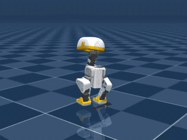
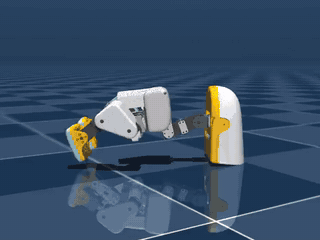
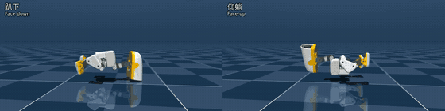
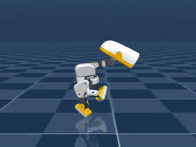
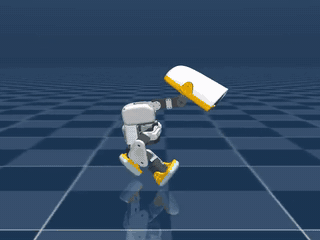
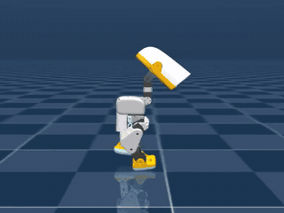
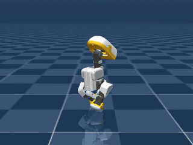

# microduck_rl_unilab

[English](README.md) | [中文](README.zh.md)

Pollen Robotics MicroDuck 机器人 RL 训练仓库，**只依赖 UniLab 的包分发，不依赖 UniLab 源码**。
任务复刻上游 [pollen-robotics/microduck_rl](https://github.com/pollen-robotics/microduck_rl)
@ `29e887e`（对齐契约见 `src/microduck_rl_unilab/tasks/microduck/alignment_contract.py`，
审计脚本 `scripts/audit_microduck_alignment.py`）。

本仓库展示 UniLab 对外部分发的两个对接缝（seam）：

1. **任务注册**：`UNILAB_EXTRA_REGISTRY_PACKAGES` 环境变量让 UniLab 的
   `ensure_registries()` 导入本仓库的任务包（含 spawn 子进程）。
2. **配置组合**：Hydra `--config-dir` 把 `src/microduck_rl_unilab/conf/<algo>` 追加进
   对应算法 UniLab 训练脚本的 config search path，外部 `task=<task>/<sim>` owner YAML
   直接参与组合；conf 树按算法分目录（`conf/ppo/`、`conf/sac/`），与 UniLab 仓内布局一致。

训练、回放、runner/learner/collector 全部来自 `unilab` wheel；
本仓库只携带任务代码（manager terms / recovery terms / BAM action 等）、
owner 配置和机器人 XML 资产。

## 步态一览

以下策略都已训练并验证，权重在 `examples/` 里。点击动图可查看对应的指标和复现命令。

<table>
  <tr>
    <td align="center" width="33%">
      <a href="examples/velocity_flat_mujoco/"></a><br>
      <b>平地行走</b>（<code>microduck_velocity_flat</code>）<br>
      跟随 0.4 m/s 前进指令
    </td>
    <td align="center" width="33%">
      <a href="examples/standup/"></a><br>
      <b>起身</b>（<code>microduck_standup_flat</code>）<br>
      从趴下、仰躺起身，也能从坐姿站起
    </td>
    <td align="center" width="33%">
      <a href="examples/velstand_getup/"></a><br>
      <b>行走与跌倒起身</b>（<code>microduck_velstand_flat</code>）<br>
      趴下（左）和仰躺（右）都在 8 秒内站起；半速播放
    </td>
  </tr>
  <tr>
    <td align="center">
      <a href="examples/sprint_straight_fast/"></a><br>
      <b>直线冲刺</b>（<code>sprint_straight_fast</code>）<br>
      1.15 m/s，300 秒保持直线
    </td>
    <td align="center">
      <a href="examples/sprint_straight_cmd/"></a><br>
      <b>速度可控冲刺</b>（<code>sprint_straight_cmd</code>）<br>
      跟随 0.3–1.2 m/s；画面为 1.2 m/s 命令
    </td>
    <td align="center">
      <a href="examples/sprint_straight_head/"></a><br>
      <b>收头冲刺</b>（<code>sprint_straight_head</code>）<br>
      跟随 0.3–1.0 m/s，目标角按真实舵机裁剪
    </td>
  </tr>
  <tr>
    <td align="center">
      <a href="examples/sprint_steer/"></a><br>
      <b>转向</b>（<code>sprint_steer</code>）<br>
      前进速度和偏航角速度都可控；画面为 0.5 m/s、+0.4 rad/s。<a href="examples/sprint_stand/"><code>sprint_stand</code></a> 在此基础上加了原地站立，上实机从它开始
    </td>
    <td></td>
    <td></td>
  </tr>
</table>

冲刺步态是本仓库独有的，上游 microduck_rl 没有冲刺任务。各冲刺权重之间的区别见[冲刺系列对比](#冲刺系列对比)。尚未完成的部分（平地速度 SAC、只支持 MJWarp 的任务）列在 [`CHANGELOG.md`](CHANGELOG.md#known-limitations) 里。

要把策略部署到实机，见 [`docs/DEPLOY.md`](docs/DEPLOY.md)：观测和动作的接口约定、导出好的 ONNX（在 [`examples/sprint_stand/deploy/`](examples/sprint_stand/deploy/)），以及已知的 sim2real 限制。

## 版本

当前版本：**0.3.0**（git 标签 `v0.3.0`）。这一版包含哪些内容、哪些策略已验证、有哪些已知限制，见 [`CHANGELOG.md`](CHANGELOG.md)。

## 仿真器分工：MuJoCo 训练，MotrixSim 验证

冲刺策略**只在 MuJoCo 上训练**。**MotrixSim 留作 sim2sim 验证**，不参与训练，这样它的结论才独立于策略拟合过的仿真器。

- MuJoCo 支持步态依赖的全部随机化（定时推力、关节电枢、脚底摩擦、刚体惯量），Motrix 不支持这四项。
- Motrix 的接触模型和 MuJoCo 不同，能发现依赖 MuJoCo 特有细节的步态。[`docs/audits/motrix_crosscheck.md`](docs/audits/motrix_crosscheck.md) 里的交叉验证发现，1.0 m/s 步态在 Motrix 上存活率掉 16–36 个点。
- 把 Motrix 也拿来训练只会转移过拟合、不会消除它（见 [PR #11](https://github.com/rocPAI-Forge/microduck_rl_unilab/pull/11)），还会用掉唯一一个留作验证的仿真器。

模型必须先通过 Motrix 验证门槛才能发布：

```bash
uv run --no-sync scripts/sim2sim_check.py examples/sprint_stand/model_59000.pt
```

门槛内容：开启目标裁剪，512 个环境，0、0.3、0.6 m/s 直线各跑 300 秒，0.5 m/s 下 ±0.4 rad/s 转弯各跑 60 秒。每项存活率至少 95%，转弯的转向速率误差不超过 0.10 rad/s。1.0 m/s 只测量和报告，不作为门槛。没通过时，在 MuJoCo 这边修（加宽随机化、调奖励、降低指令范围），不要拿 Motrix 去训练。真机是最终标准，有了真机数据后再回头调整这个门槛。

## 任务 × 算法 × 后端矩阵

| task | ppo | sac |
|------|-----|-----|
| `microduck_velocity_flat` | mujoco, motrix | mujoco, motrix |
| `microduck_velstand_flat` | mujoco | — |
| `microduck_standup_flat` | mujoco | — |
| `microduck_sprint_flat` 及其 19 个续训 owner（`robust`、`gaitfix`、`rollfix`、`steerfix`、`straightfix`、`straightspeed`、`straighthold`、`straightcmd`、`straightrange`、`straightclip`、`straightneck`、`straighthead`、`steer`、`steermix`、`stand`、`standturn`、`pivot`、`pivothold`、`pivotsym`） | mujoco | — |
| `microduck_ground_pick_flat`、`microduck_sitstand_flat` | mjwarp | — |

每个冲刺续训 owner 的完整名字是 `microduck_sprint_<名字>_flat`，用到它的示例 README 里有具体命令。

`microduck_velocity_flat` 的 PPO 已按 owner 预算训完（2026-10-15，2048 环境，500 轮，`algo.seed=42`）。MuJoCo 上 0.4 m/s 前进指令的 10 秒跟踪镜头已看过，能站住并迈步。Motrix 没有推理视频。

| 后端 | 最终平均回报 | 权重 / 视频 |
|---|---:|---|
| mujoco | 93.01 | [`model_499.pt`](examples/velocity_flat_mujoco/model_499.pt) / [`play_video.mp4`](examples/velocity_flat_mujoco/play_video.mp4) |
| motrix（`motrixsim-core==0.8.2`） | 145.44 | [`examples/velocity_flat_motrix/model_499.pt`](examples/velocity_flat_motrix/model_499.pt) |

训练复现状态（只有指标和推理视频都通过才记为完成）：

| 策略 | 状态 | checkpoint / 视频 |
|---|---|---|
| `microduck_standup_flat` PPO | 完成；15000 轮。慢放侧面近景依次是趴着撑起、仰着翻身站起、坐着站起 | [`examples/standup/model_14999.pt`](examples/standup/model_14999.pt) / [`play_video.mp4`](examples/standup/play_video.mp4) |
| `microduck_velstand_flat` PPO | 完成。64 次强制跌倒中，趴下和仰躺都在 8 秒内站起（末态倾角 1.2°），原地指令和默认行走指令都成立 | [`examples/velstand_getup/model_12498.pt`](examples/velstand_getup/model_12498.pt) / [`play_video_getup.mp4`](examples/velstand_getup/play_video_getup.mp4) |
| `microduck_velocity_flat` SAC | **未通过**；5000 轮训练完成，但推理反复倒地重置，不能作为成品策略。失败样本留在本地 `logs/`，不入库 | — |
| `sprint_speed_1p68` PPO | 完成，约 1.68 m/s。Sprint 不是上游 microduck_rl 的官方任务，是本仓库独有的冲刺步态 | [`examples/sprint_speed_1p68/model_11997.pt`](examples/sprint_speed_1p68/model_11997.pt) |
| `sprint_head_upright` PPO | 完成，约 1.32 m/s，头朝上。同上，本仓库独有 | [`examples/sprint_head_upright/model_14500.pt`](examples/sprint_head_upright/model_14500.pt) |
| `sprint_straight_long` PPO | 完成，约 0.83 m/s，300 秒走直。同上，本仓库独有 | [`examples/sprint_straight_long/model_19297.pt`](examples/sprint_straight_long/model_19297.pt) |
| `sprint_straight_fast` PPO | 完成，约 1.15 m/s，三个种子的 300 秒直线通过率 93–99%。同上，本仓库独有 | [`examples/sprint_straight_fast/model_27000.pt`](examples/sprint_straight_fast/model_27000.pt) / [`play_video_side.mp4`](examples/sprint_straight_fast/play_video_side.mp4) |
| `sprint_straight_cmd` PPO | 完成，跟随 0.3–1.2 m/s 前进速度命令（实测 0.31–1.12 m/s），各档 300 秒直线通过率 90–99.6%。同上，本仓库独有 | [`examples/sprint_straight_cmd/model_32250.pt`](examples/sprint_straight_cmd/model_32250.pt) / [`play_video_side_v0.6.mp4`](examples/sprint_straight_cmd/play_video_side_v0.6.mp4) |
| `sprint_straight_head` PPO | 完成，0.3–1.0 m/s 速度命令，位置目标裁剪到关节行程内，头回到躯干上方（前伸约 3 cm，原来约 9 cm）。300 秒直线通过率 93.6–100%。同上，本仓库独有 | [`examples/sprint_straight_head/model_52250.pt`](examples/sprint_straight_head/model_52250.pt) / [`play_video_side_v0.5.mp4`](examples/sprint_straight_head/play_video_side_v0.5.mp4) |
| `sprint_steer` PPO | 完成。前进速度 0.3–1.0 m/s 和偏航角速度都可控，目标角按舵机裁剪，头在躯干上方。±0.2、±0.4 rad/s 的偏航误差 ≤ 0.05 rad/s，转弯存活 97–100%。同上，本仓库独有 | [`examples/sprint_steer/model_55999.pt`](examples/sprint_steer/model_55999.pt) / [`play_video_turn_left_v0.5.mp4`](examples/sprint_steer/play_video_turn_left_v0.5.mp4) |
| `sprint_stand` PPO | 完成。在 `sprint_steer` 基础上加原地站立：前进 0–1.0 m/s、偏航角速度都可控，目标角按舵机裁剪。站立 300 秒存活 99.8%，位置漂移 9 cm。不会原地转向。同上，本仓库独有 | [`examples/sprint_stand/model_59000.pt`](examples/sprint_stand/model_59000.pt) / [`play_video_stand.mp4`](examples/sprint_stand/play_video_stand.mp4) |
| `sprint_steerfix_flat` PPO | 未训练，已被 `sprint_steer` 取代。同上，本仓库独有；配置在，没有权重 | — |

任务与上游 microduck_rl 保持 1:1：BAM（bam xl330-m6 电压伺服模型，
`BamVoltageAction` 逐 substep 力矩路径）是上游唯一的驱动器模型，因此本仓库
所有任务统一走 BAM，不再保留早期移植的简化位置驱动变体。
BAM 的 substep 状态反馈契约（`SimBackend.set_pre_step_control`）在 mujoco 与
motrix 后端可用。motrix 上关掉了该后端没有的速度推力、关节 armature、足端摩擦和惯量随机化。

## 安装

```bash
git clone https://github.com/unilabsim/microduck_rl_unilab.git
cd microduck_rl_unilab
# ROCm（默认）：Linux x86_64 从 ROCm 7.2 索引解析 torch 2.11.0 与 triton-rocm 3.6.0。
# 需要系统 ROCm >= 7.1。
uv sync
```

CUDA 是另一套配置（Linux x86_64 与 Windows 上为 cu128 索引的 `torch==2.8.0`）。
`make sync-cuda` 会把 `pyproject.cuda.toml` 和 `uv.cuda.lock` 换成当前工程文件并同步。
`make sync-rocm` 切回默认的 ROCm。两套环境的训练设备名都仍写 `cuda`。不要把换进去的文件提交。

> **依赖**：`unilab[mujoco]==1.0.0`、`unilab-rl==1.0.0`、`unisim-core==1.0.0`
> 全部从生产 PyPI 解析。unilab 1.0.0 起包含仓内 microduck 任务移除（PR #1495）、
> `read_reset_root_pose` 基础 API（PR #1494）与 `unilab-rl==1.0.0` 升级（PR #1496）。
> `--sim motrix` 另需 `unilab[motrix]`（`motrixsim-core==0.8.2`）。

## 训练

在仓库根目录执行（`env.scene.model_file` 相对仓库根解析）：

```bash
uv run microduck-train --algo ppo --task microduck_velocity_flat --sim mujoco
uv run microduck-train --algo ppo --task microduck_sprint_flat --sim mujoco
uv run microduck-train --algo ppo --task microduck_velocity_flat --sim motrix
uv run microduck-train --algo ppo --task microduck_standup_flat --sim mujoco
uv run microduck-train --algo sac --task microduck_velocity_flat --sim mujoco
```

短程冒烟（4 个 env、2 次迭代、不回放）：

```bash
uv run microduck-train --algo ppo --task microduck_velocity_flat --sim mujoco \
  algo.num_envs=4 algo.max_iterations=2 training.no_play=true training.play_env_num=4
```

任意 UniLab Hydra override 均可透传（如 `algo.num_envs=512`、
`training.logger=wandb`）。

## 回放

```bash
uv run microduck-eval --algo ppo --task microduck_velocity_flat --sim mujoco --load-run -1
```

Sprint 评估口径为 2.20 m/s 前向命令、1 秒预热、10 秒测量：

```bash
uv run --no-sync scripts/eval_sprint_speed.py \
  examples/sprint_speed_1p68/model_11997.pt
```

从已训好的速度策略做三段 robustify（钉住 1.65–2.20 m/s 命令带，逐步加 push / CoM / 倾角）：

```bash
uv run --no-sync scripts/train_sprint_robust.py \
  --load-run <sprint-run> --checkpoint <last-iter> --stages B
```

## 示例 checkpoint

| 示例 | 速度 | 存活 | 头部倒置 | 说明 |
|---|---|---|---|---|
| [`examples/sprint_speed_1p68/`](examples/sprint_speed_1p68/) | 1.682 m/s | 89.8% | ~91% | 速度配方。大腿已左右交替；颈部折叠，头大部分时间倒置。 |
| [`examples/sprint_head_upright/`](examples/sprint_head_upright/) | 1.315 m/s | 97.9% | 0.6% | 同一套交替步态，头顶朝天、面朝前；10 s 航向仍约 42° 左偏。 |
| [`examples/sprint_straight_long/`](examples/sprint_straight_long/) | ~0.83 m/s 长时 | 300 s 100% | 0 | 续训后闭环节航向 + 横向误差。300 s 平均航向 1.7°，直姿窗口 295 s。 |
| [`examples/sprint_straight_fast/`](examples/sprint_straight_fast/) | ~1.15 m/s 长时 | 300 s 98.4–100% | ≤ 0.02% | 同一闭环，放宽速度跟踪核，加跌倒惩罚、头翻转代价和压测级推力。300 s 平均航向 1.7–1.8°，直线通过率 93–99%；600 s 通过率 94.5%。 |
| [`examples/sprint_straight_cmd/`](examples/sprint_straight_cmd/) | 0.3–1.2 m/s 命令 | 300 s 94.7–99.6% | ≤ 0.4% | 速度跟随命令。0.3 / 0.6 / 0.9 / 1.2 m/s 的直线通过率 97.5 / 99.6 / 96.9 / 90.0%；压测存活 ≥ 95%。慢速跌倒只发生在开场 6 秒内。目标不裁剪，头顶在限位上。 |
| [`examples/sprint_straight_head/`](examples/sprint_straight_head/) | 0.3–1.0 m/s 命令 | 300 s 94.9–100% | ≤ 0.01% | 目标裁剪到关节行程内（接近真实舵机），头回到躯干上方。0.3–0.75 m/s 在 300 秒内无跌倒；1.0 m/s 命令实测 0.93 m/s。评测和回放需加 `--clip-targets`。 |
| [`examples/sprint_steer/`](examples/sprint_steer/) | 0.3–1.0 m/s 和 ±0.4 rad/s | 直行 300 s 93.4–100%；转弯 96.7–100% | ≤ 0.01% | 在 `sprint_straight_head` 基础上加偏航转向。直行由出生航向闭环充当外部偏航控制器。评测和回放需加 `--clip-targets`。 |
| [`examples/sprint_stand/`](examples/sprint_stand/) | 0–1.0 m/s 和 ±0.4 rad/s | 直行 300 s 95.1–100%；转弯 98–100% | ≤ 0.01% | 在 `sprint_steer` 基础上加原地站立。不会原地转向；站立时 300 秒内航向平均漂移约 6.5°。评测和回放需加 `--clip-targets`。 |

每个目录含 `model_*.pt`、可视化、`metrics.json` 和复现命令。
`model.pt` 约 4.7 MB，直接入 git。

### 冲刺系列对比

八个冲刺示例是一条续训链，后一个都从前一个的权重接着训。

| 示例 | 权重 | 速度命令 | 实测速度 | 头部姿态 | 关节目标 | 长时直线 | 压力测试存活 |
|---|---|---|---|---|---|---|---|
| `sprint_speed_1p68` | `model_11997` | 固定 2.2 m/s | 1.68 m/s | 约 91% 时间头倒置 | 远超行程 | 不走直，10 s 偏 42° | — |
| `sprint_head_upright` | `model_14500` | 固定 2.2 m/s | 1.32 m/s | 头顶朝上，颈部顶限位 | 远超行程 | 不走直，10 s 偏 42° | — |
| `sprint_straight_long` | `model_19297` | 固定 2.2 m/s | 0.83 m/s | 头朝上，前伸约 8 cm | 远超行程 | 300 s 直线通过率 94–95% | 93–94% |
| `sprint_straight_fast` | `model_27000` | 固定 2.2 m/s | 1.15 m/s | 同上 | 远超行程 | 300 s 93–99%，600 s 94.5% | 96–97% |
| `sprint_straight_cmd` | `model_32250` | 0.3–1.2 m/s 可控 | 0.31–1.12 m/s | 头朝上，前伸约 8 cm | 远超行程 | 300 s 90–99.6%（1.2 m/s 最弱） | ≥ 95% |
| `sprint_straight_head` | `model_52250` | 0.3–1.0 m/s 可控 | 0.30–0.93 m/s | 头在躯干上方，前伸约 3 cm | 裁剪在行程内 | 300 s 93.6–100%（1.0 m/s 最弱） | 97–100% |
| `sprint_steer` | `model_55999` | 0.3–1.0 m/s 和 ±0.4 rad/s 偏航，均可控 | 0.29–0.90 m/s；偏航误差 ≤ 0.05 rad/s | 头在躯干上方，前伸 2–3 cm | 裁剪在行程内 | 300 s 92–100%（1.0 m/s 最弱） | 96.5–100% |
| `sprint_stand` | `model_59000` | 0–1.0 m/s 和 ±0.4 rad/s 偏航，均可控；零速时站立 | 0–0.88 m/s；偏航误差 ≤ 0.06 rad/s | 头在躯干上方，前伸 3–5 cm | 裁剪在行程内 | 行走 300 s 93.9–100%；站立存活 99.8% | 97.9–99.8% |

- **速度命令：**只有最后四个能按速度命令跑，前四个不管命令多少，都跑自己那一个速度。`sprint_steer` 和 `sprint_stand` 还能按偏航角速度命令转弯，只有 `sprint_stand` 能在零速命令下站住。
- **关节目标：**前五个的 `hip_yaw` 和 `neck_pitch` 目标角都远超关节行程，靠顶住限位维持平衡。真实舵机会把目标限制在行程内；打开这个裁剪后，`model_32250` 的 60 秒存活在 0.3 m/s 只有 18.8%，在 1.2 m/s 是 0%。只有 `sprint_straight_head`、`sprint_steer` 和 `sprint_stand` 是在裁剪条件下训练的。
- **头部姿态：**`sprint_head_upright` 靠把 `neck_pitch` 折到 −90° 的限位来扶正头顶，头因此伸在躯干前方。这个姿态一直延续到 `sprint_straight_cmd`，`sprint_straight_head` 才把脖子抬回接近默认站姿。
- **数据可比性：**各示例的评测条件不同。前两个是 10 秒、512 个环境；中间两个是 128 个环境；后两个是 512 个环境、按各自的速度档评测。详见各目录的 `metrics.json`。

要在仿真里跑得最快，用 `sprint_straight_cmd`；要往实机部署，从 `sprint_stand` 开始：它在舵机裁剪条件下同时覆盖站立、行走和转向。

跌倒起身示例 [`examples/velstand_getup/`](examples/velstand_getup/)：

| 文件 | 内容 |
|---|---|
| [`model_12498.pt`](examples/velstand_getup/model_12498.pt) | 已观察权重。换入 standup 动作网络后，原地起身训 800 轮，再混入行走指令训 1200 轮 |
| [`play_video_getup.mp4`](examples/velstand_getup/play_video_getup.mp4) | 左右同时、1/2 原速度，约 8 秒。左：趴下。右：仰躺。同一策略 |

64 次强制跌倒里，两种姿态都在 8 秒内站起，8 秒末平均倾角 1.2°；保留默认行走指令时同样成立。直接回放会从站立开场，因为课程表第 0 阶段把 `prone_prob` 写回 0。复现命令在该目录的 README 里。

长时直线评测（需要闭环 owner，不要用默认 `microduck_sprint_flat`）：

```bash
uv run --no-sync scripts/eval_sprint_speed.py \
  examples/sprint_straight_long/model_19297.pt \
  --owner microduck_sprint_straightfix_flat/mujoco \
  --duration 300 --num-envs 128
```

快速直线示例用同一套评测，owner 换成不加推力的 straightspeed；压力测试用 straighthold owner。六段训练链（`scripts/train_sprint_straight_speed.py`）写在 [`examples/sprint_straight_fast/README.md`](examples/sprint_straight_fast/README.md)：

```bash
uv run --no-sync scripts/eval_sprint_speed.py \
  examples/sprint_straight_fast/model_27000.pt \
  --owner microduck_sprint_straightspeed_flat/mujoco \
  --duration 300 --num-envs 128
uv run --no-sync scripts/eval_sprint_speed.py \
  examples/sprint_straight_fast/model_27000.pt \
  --owner microduck_sprint_straighthold_flat/mujoco --stress \
  --duration 60 --num-envs 128
```

速度命令示例在同一套 owner 上用 `--speed` 取 0.3–1.2 m/s，训练链写在 [`examples/sprint_straight_cmd/README.md`](examples/sprint_straight_cmd/README.md)：

```bash
uv run --no-sync scripts/eval_sprint_speed.py \
  examples/sprint_straight_cmd/model_32250.pt \
  --owner microduck_sprint_straightspeed_flat/mujoco \
  --speed 0.6 --duration 300 --num-envs 512
```

收头示例训练时把位置目标裁剪到了关节行程内，评测和回放都要加 `--clip-targets`。训练链写在 [`examples/sprint_straight_head/README.md`](examples/sprint_straight_head/README.md)：

```bash
uv run --no-sync scripts/eval_sprint_speed.py \
  examples/sprint_straight_head/model_52250.pt --clip-targets \
  --owner microduck_sprint_straightspeed_flat/mujoco \
  --speed 0.5 --duration 300 --num-envs 512
```

## 吞吐

短程 PPO 吞吐记在 [`benchmark/`](benchmark/README.md)。2026-10-14 在 RX 9070 XT 上，`microduck_velocity_flat`、256 环境、5 轮的最终吞吐：MuJoCo 14,629 steps/s，MotrixSim 13,503 steps/s。

## 测试

```bash
uv run pytest tests/ -x -q
```

`tests/conftest.py` 复现两个 seam：设置 `UNILAB_EXTRA_REGISTRY_PACKAGES` 并通过
Hydra `SearchPathPlugin` 把本仓库 `conf/<algo>` 追加进 config search path
（测试不经 CLI，无法用 `--config-dir`）。

## 资产策略

全部 MicroDuck 资产（7 个 XML + 47 个 STL + 上游 LICENSE + sha256 清单）随仓库
入 git，开箱即用；`assets.py` 仅作为兜底——文件缺失时才从 Hugging Face 数据集
[`unilabsim/unilab-robots`](https://huggingface.co/datasets/unilabsim/unilab-robots)
补齐（冷路径）。STL 来源为上游 pollen-robotics/microduck_rl（Apache-2.0，
见 `assets/robots/microduck/LICENSE.pollen-robotics.txt`），完整性由
`assets/robots/microduck/assets.sha256` 与 `tests/test_asset_contract.py` 保证。

## 仓库结构

```text
assets/robots/microduck/            # 机器人 XML + STL + LICENSE + sha256 清单（全部入 git）
src/microduck_rl_unilab/
├── assets.py                       # 冷路径资产物化（snapshot_download 兜底）
├── cli.py                          # microduck-train / microduck-eval：env var + --config-dir 注入
├── conf_searchpath.py              # Hydra SearchPathPlugin（测试/脚本的程序化 compose 用）
├── conf/
│   ├── ppo/task/microduck_{velocity_flat,velstand_flat,standup_flat,ground_pick_flat,sitstand_flat,sprint_*_flat}/
│   └── sac/task/microduck_velocity_flat/
└── tasks/
    ├── __init__.py                 # __unilab_registry_modules__
    └── microduck/
        ├── __init__.py             # 任务 registry.register_env
        ├── manager_terms.py        # velocity command / 奖励 terms
        ├── sprint_terms.py         # sprint 速度/航向奖励与速度课程
        ├── recovery_terms.py       # velstand 跌倒恢复 terms
        ├── standup_terms.py        # standup / ground_pick / sitstand terms
        ├── bam_action.py           # BAM 电压驱动 action term
        ├── deploy_contract.py      # obs/action 维度契约
        ├── alignment_contract.py   # 上游 microduck_rl @ 29e887e 对齐契约表
        └── sim2real_notes.py       # sim2real 注意事项
benchmark/                          # 吞吐实测（硬件、规模、对照）
docs/media/                         # README 预览动图，从示例视频剪辑而来
tests/                              # 迁移自 UniLab 的契约/对齐测试套件
scripts/                            # 对齐审计 / 对比 / rollout 脚本
```
