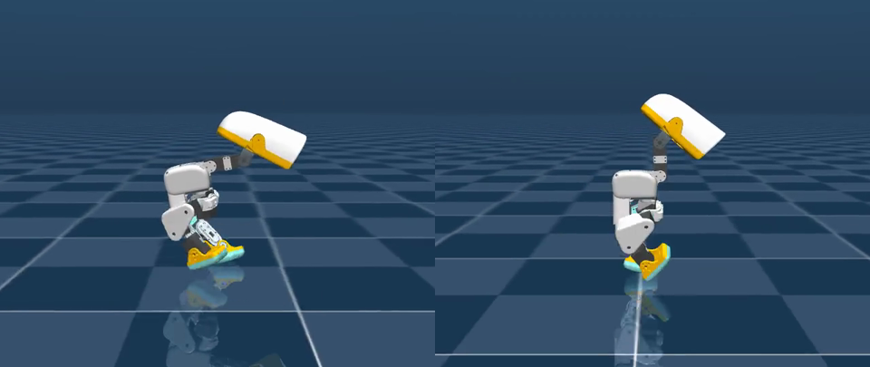

# Sprint head-over-trunk straight example (0.3–1.0 m/s, clamped targets)

Continuation of [`../sprint_straight_cmd/`](../sprint_straight_cmd/). Same
speed command, spawn-heading loop, and alternating gait, with two changes
that matter on hardware:

- **Position targets stay inside the joint range.** Every sprint policy from
  the 1.68 m/s recipe on commanded `hip_yaw` and `neck_pitch` targets tens of
  radians past their stops (`model_32250`: about −102 / +23 rad on the two
  `hip_yaw` joints and −19 rad on `neck_pitch`). The BAM action does not clip
  `q_des`, so those joints sat on the stop at full voltage. A real servo clamps
  its goal position. This policy is trained and evaluated with the clamp on
  (`clip_target_to_joint_limits: true`).
- **The head is back over the trunk.** `neck_pitch` moves from its −90° stop to
  about 0° (home is +20°). The head now rides about 3 cm ahead of
  `trunk_base` instead of about 9 cm.

The price is top speed: with the clamp on and the head back the gait tops out
near 1.04 m/s, so the command band is 0.3–1.0 m/s.



## Battery

512 environments, seed 777, targets clamped. Clean is
`microduck_sprint_straightspeed_flat/mujoco`; stress is
`microduck_sprint_straighthold_flat/mujoco --stress` (push 0.10 m/s, trunk CoM
10 mm, head CoM 6 mm, 2° reset tilt):

| Command | Measured speed | Clean 300 s survival | Clean 300 s straight-pose pass | Stress 60 s survival | Head ahead of trunk | `neck_pitch` |
|---|---:|---:|---:|---:|---:|---:|
| 0.3 m/s | 0.301 m/s | 100% | 100% | 99.6% | 3.7 cm | −1.4° |
| 0.5 m/s | 0.496 m/s | 100% | 100% | 100% | 3.2 cm | +1.2° |
| 0.75 m/s | 0.722 m/s | 100% | 100% | 100% | 2.9 cm | +3.0° |
| 1.0 m/s | 0.927 m/s | 94.9% | 93.6% | 97.1% | 3.1 cm | +2.9° |

No environment falls in 300 s at 0.3–0.75 m/s. Mean heading error is
1.3–1.7°, and head yaw and roll stay within 0.5°. Thigh and foot sign-flip stay
at 0.48–0.49.

Raw numbers: [`metrics.json`](metrics.json). Clips, all with the clamp on:

- [`play_video_side_v0.3.mp4`](play_video_side_v0.3.mp4),
  [`play_video_side_v0.5.mp4`](play_video_side_v0.5.mp4),
  [`play_video_side_v0.75.mp4`](play_video_side_v0.75.mp4),
  [`play_video_side_v1.0.mp4`](play_video_side_v1.0.mp4) — 8 s close side view
  at full 50 fps for each command, from a standing start.
- [`play_video_radial.mp4`](play_video_radial.mp4) — 8 s far overhead of eight
  robots at a 1.0 m/s command on headings 0°, 45°, …, 315°.

## Known limits

- A 1.0 m/s command runs about 0.93 m/s, and 1.0 m/s is the weakest speed.
- At a 1.2 m/s command the same gait (`model_50750`, before the band cap) held
  only about 87% survival and 84% straight-pose pass for 300 s on 512
  environments. That is why the band stops at 1.0.
- For a 1.2 m/s command use [`../sprint_straight_cmd/`](../sprint_straight_cmd/)
  instead. It is faster and steady up to 1.2 m/s, but only with unclamped
  targets and the head on its stop.
- Training pushed at up to 0.10 m/s, the same magnitude as the stress battery,
  so the stress numbers are held out for CoM and tilt but not for push size.
- `play_video_side_v*.mp4` and the eval commands below must pass
  `--clip-targets`; without it the policy runs in dynamics it was not trained
  on.

## What changed

The actor contract (61D observation, 14D action) is unchanged.

1. **Price the request, not the joint.** `action_target_overshoot_cost` charges
   the BAM target for every radian past the soft limits. It reads the target
   rather than the joint, so it keeps a gradient while the joint sits on the
   stop. Three rounds (`microduck_sprint_straightrange_flat`, weights ramped
   to −0.06, then −0.1 and −0.3) pulled the summed overshoot from about
   150 rad to about 2.6 rad without changing the gait, then plateaued.
2. **Clamp with a shrinking margin.** Clamping outright at that point dropped
   survival to 13% (0.3 m/s) and 0% (1.2 m/s): the last ~0.45 rad on each
   `hip_yaw`/`hip_roll` still held about a quarter of full voltage against the
   stops. `microduck_sprint_straightclip_flat` clamps 0.5 rad outside the
   limits and steps that margin to 0 over 2000 iterations. The hip requests
   came back inside their range, and top speed fell from about 1.12 to
   about 1.00 m/s.
3. **Put the head band on the request.** Under the clamp, the `neck_pitch`
   request still sat about 0.37 rad past the stop, where the clamp pins it.
   Ramping the joint-space `head_pitch_band` to −12 moved nothing.
   `action_target_band_cost` applies the same band to the request instead
   (`microduck_sprint_straightneck_flat`). The neck left the stop. Narrowing
   the lower edge from −50° to −15° brought the head to about 3 cm.
4. **Cap the band where the gait can track.**
   `microduck_sprint_straighthead_flat` pins that head contract and samples
   0.3–1.0 m/s, with 40% of resamples drawn from 0.75–1.0 m/s.

## Train

Every step runs through `scripts/train_sprint_straight_speed.py`. Each one
resumes the previous step's kept checkpoint (`<run-N>` is that step's run
directory under `logs/`). Steps 4–8 score with `--eval-clip`.

```bash
SCORE="--eval-speeds 0.3,0.6,0.9,1.2 --eval-duration 120 --eval-envs 128 \
  --stress-speeds 0.3,1.2 --stress-duration 60"

# 1. Pull targets back toward the range (overshoot weight ramps to -0.06).
uv run --no-sync scripts/train_sprint_straight_speed.py \
  --task microduck_sprint_straightrange_flat \
  --load-run "$(pwd)/examples/sprint_straight_cmd" --checkpoint 32250 \
  --iterations 3000 --algo-log-name rsl_rl_ppo_straightrange_r1 $SCORE \
  --max-speed-error 0.10 --max-target-overshoot 1.0
# keep model_35249

# 2-3. Same owner, overshoot weight pinned at -0.1, then -0.3.
uv run --no-sync scripts/train_sprint_straight_speed.py \
  --task microduck_sprint_straightrange_flat \
  --load-run <run-1> --checkpoint 35249 --iterations 2000 \
  --algo-log-name rsl_rl_ppo_straightrange_r2 $SCORE \
  --max-speed-error 0.10 --max-target-overshoot 1.0 \
  --override env.curriculum.action_target_overshoot_weight=null \
  --override reward.action_target_overshoot.weight=-0.1
# keep model_37248
uv run --no-sync scripts/train_sprint_straight_speed.py \
  --task microduck_sprint_straightrange_flat \
  --load-run <run-2> --checkpoint 37248 --iterations 2000 \
  --algo-log-name rsl_rl_ppo_straightrange_r3 $SCORE \
  --max-speed-error 0.10 --max-target-overshoot 1.0 \
  --override env.curriculum.action_target_overshoot_weight=null \
  --override reward.action_target_overshoot.weight=-0.3
# keep model_39247

# 4. Clamp targets; margin 0.5 -> 0 rad.
uv run --no-sync scripts/train_sprint_straight_speed.py \
  --task microduck_sprint_straightclip_flat \
  --load-run <run-3> --checkpoint 39247 --iterations 3000 \
  --algo-log-name rsl_rl_ppo_straightclip_k1 $SCORE --eval-clip \
  --max-speed-error 0.10
# keep model_42000

# 5. Joint-space neck band ramp. Recorded for fidelity; it did not move the neck.
uv run --no-sync scripts/train_sprint_straight_speed.py \
  --task microduck_sprint_straightneck_flat \
  --load-run <run-4> --checkpoint 42000 --iterations 3000 \
  --algo-log-name rsl_rl_ppo_straightneck_n2 $SCORE --eval-clip \
  --max-speed-error 0.25 --max-head-forward 0.05 \
  --override reward.head_pitch_target_band.weight=0.0 \
  --override env.curriculum.head_pitch_target_band_weight=null \
  --override '+env.curriculum.head_pitch_band_weight={func:unilab.envs.mdp.reward_curriculum,params:{reward_name:head_pitch_band,stages:[{step:0,weight:-1.5},{step:12000,weight:-3.0},{step:24000,weight:-6.0},{step:36000,weight:-9.0},{step:48000,weight:-12.0}]}}'
# keep model_44999

# 6. Request-space neck band, ramped to -12.
uv run --no-sync scripts/train_sprint_straight_speed.py \
  --task microduck_sprint_straightneck_flat \
  --load-run <run-5> --checkpoint 44999 --iterations 3000 \
  --algo-log-name rsl_rl_ppo_straightneck_n3 $SCORE --eval-clip \
  --max-speed-error 0.25 --max-head-forward 0.05
# keep model_47998

# 7. Narrow the neck band's lower edge to -15 deg at weight -12.
uv run --no-sync scripts/train_sprint_straight_speed.py \
  --task microduck_sprint_straightneck_flat \
  --load-run <run-6> --checkpoint 47998 --iterations 3000 \
  --algo-log-name rsl_rl_ppo_straightneck_n4 $SCORE --eval-clip \
  --max-speed-error 0.25 --max-head-forward 0.05 \
  --override env.curriculum.head_pitch_target_band_weight=null \
  --override reward.head_pitch_target_band.weight=-12.0 \
  --override 'reward.head_pitch_target_band.params.band_deg=[[-15.0,45.0],[-50.0,50.0]]'
# keep model_50750

# 8. Cap the command band at 1.0 m/s.
uv run --no-sync scripts/train_sprint_straight_speed.py \
  --task microduck_sprint_straighthead_flat \
  --load-run <run-7> --checkpoint 50750 --iterations 2000 \
  --algo-log-name rsl_rl_ppo_straighthead_h1 --eval-clip \
  --eval-speeds 0.3,0.5,0.75,1.0 --eval-duration 120 --eval-envs 128 \
  --stress-speeds 0.3,1.0 --stress-duration 60 \
  --max-speed-error 0.10 --max-head-forward 0.05
# keep model_52250
```

Step 5's overrides reproduce the joint-space owner that run used; its recorded
config differs from the composed one only by the zero-weight request band.

## Eval / play

```bash
for v in 0.3 0.5 0.75 1.0; do
  uv run --no-sync scripts/eval_sprint_speed.py \
    examples/sprint_straight_head/model_52250.pt --clip-targets \
    --owner microduck_sprint_straightspeed_flat/mujoco \
    --speed $v --duration 300 --num-envs 512 --seed 777
  uv run --no-sync scripts/eval_sprint_speed.py \
    examples/sprint_straight_head/model_52250.pt --clip-targets \
    --owner microduck_sprint_straighthold_flat/mujoco --stress \
    --speed $v --duration 60 --num-envs 512 --seed 777
done

for v in 0.3 0.5 0.75 1.0; do
  MUJOCO_GL=egl PYOPENGL_PLATFORM=egl uv run --no-sync scripts/render_straight_demos.py \
    --checkpoint examples/sprint_straight_head/model_52250.pt --clip-targets \
    --out-dir examples/sprint_straight_head --only follow --speed $v \
    --follow-seconds 8 --stride 1 --follow-azimuth 90 --follow-elevation -8 \
    --follow-distance 0.9 --follow-name play_video_side_v$v.mp4
done
MUJOCO_GL=egl PYOPENGL_PLATFORM=egl uv run --no-sync scripts/render_straight_demos.py \
  --checkpoint examples/sprint_straight_head/model_52250.pt --clip-targets \
  --out-dir examples/sprint_straight_head --only radial --speed 1.0 --radial-seconds 8
```
